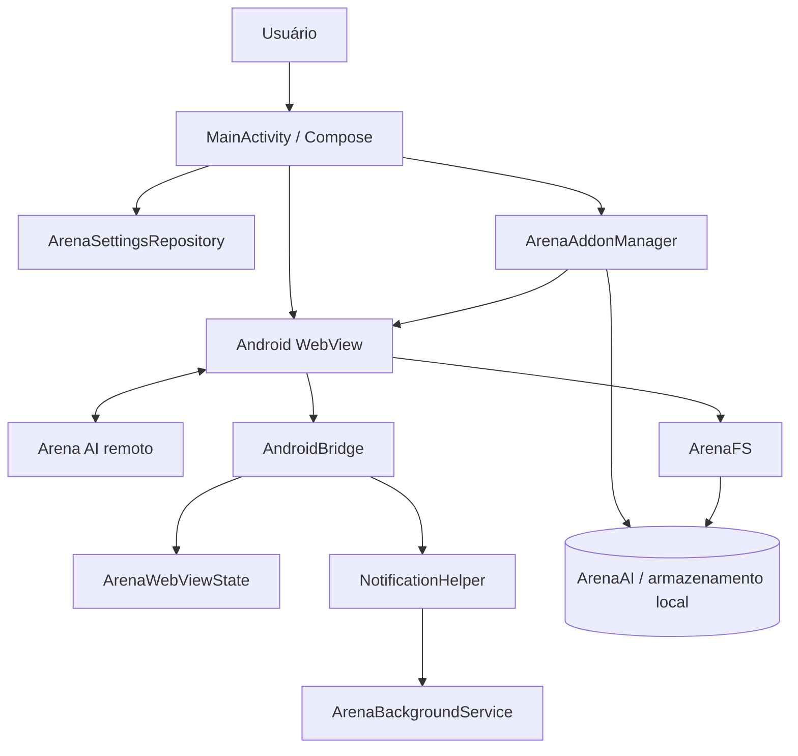

# Arquitetura

## Visão geral

O Arena AI é um cliente Android híbrido: a interface nativa é construída com Jetpack Compose, enquanto a experiência principal é carregada de `https://arena.ai/agent` em um Android WebView. O código Kotlin conecta eventos da página a recursos do sistema operacional.

## Componentes

| Arquivo | Responsabilidade |
| --- | --- |
| `MainActivity.kt` | Activity e tela Compose; coordena navegação, preferências, seletor de arquivos, autenticação assistida, WebView e pop-ups. |
| `ArenaWebViewState.kt` | Estado observável da navegação, geração, conta, configurações, arquivos e complementos. |
| `ArenaJsInterface.kt` | Expõe `AndroidBridge` ao JavaScript, recebe eventos de geração/login/notificação e injeta o monitor de DOM. |
| `ArenaFileBridge.kt` | Expõe `ArenaFS`; implementa leitura, escrita, listagem, criação e remoção de arquivos, além da seleção de diretório via SAF. |
| `ArenaAddonManager.kt` | Descobre, importa, remove, interpreta e valida extensões/plugins; constrói o SDK JavaScript e o script de injeção. |
| `ArenaSettingsRepository.kt` | Lê e persiste configurações e prepara a estrutura de diretórios dos complementos. |
| `ArenaAccountHelper.kt` | Cria o seletor de contas Android, detecta URLs de autenticação e preenche o e-mail escolhido nos fluxos compatíveis. |
| `ArenaBackgroundService.kt` | Mantém um serviço em primeiro plano e um wake lock temporário durante a execução em segundo plano. |
| `NotificationHelper.kt` | Cria canais e exibe notificações de geração, serviço e complementos encontrados. |
| `NetworkUtils.kt` | Observa a disponibilidade de conectividade para a interface Compose. |
| `ui/theme/` | Paleta, tipografia e tema da interface nativa. |

## Fluxo de inicialização

1. A Activity carrega preferências por meio de `ArenaSettingsRepository`.
2. A estrutura de trabalho `ArenaAI/` é preparada nos locais de armazenamento suportados.
3. O carregador pode procurar complementos automaticamente, conforme as preferências.
4. O WebView abre `https://arena.ai/agent`, registra as interfaces `AndroidBridge` e `ArenaFS` e ativa o monitor JavaScript da página.
5. Ao terminar o carregamento, o SDK `window.ArenaAI` é inicializado e os complementos habilitados e compatíveis são injetados.

## Persistência e armazenamento

O repositório de configurações usa `settings.json`. A implementação tenta manter cópias em:

- armazenamento externo específico do aplicativo, em `ArenaAI/`;
- armazenamento externo compartilhado, quando permitido;
- `Documents/ArenaAI/`, utilizando MediaStore nas versões compatíveis;
- diretório escolhido e autorizado pelo usuário por meio do Storage Access Framework.

A leitura também mantém compatibilidade com o caminho legado `ArenaIA/Settings.json`. O diretório padrão de complementos é `ArenaAI/extension/` e `ArenaAI/plugin/`; detalhes e formatos estão em [ADDONS.md](ADDONS.md).

## Integração com o site

A ponte `AndroidBridge` recebe eventos relacionados à geração de resposta, solicitação de login e notificações. O script de monitoramento observa mudanças no DOM e utiliza seletores e indicadores da página para estimar quando uma geração começou ou terminou.

Essa integração depende da estrutura HTML e dos comportamentos do serviço remoto. Não é uma API estável do site: mudanças no DOM podem exigir atualização dos seletores.

## Limites arquiteturais conhecidos

- O conteúdo principal é remoto; a aplicação precisa de conectividade para carregar o serviço.
- A integração com o ciclo de geração depende de heurísticas de DOM, não de um contrato de API documentado pelo serviço remoto.
- Scripts de complementos são executados no mesmo contexto do WebView e recebem acesso às APIs JavaScript expostas pelo aplicativo.
- O namespace Android configurado atualmente é `com.example`; alterá-lo exige uma migração coordenada de namespace, fontes, testes e configuração Gradle.

Esses limites devem ser considerados em mudanças de arquitetura e em qualquer análise de segurança.
